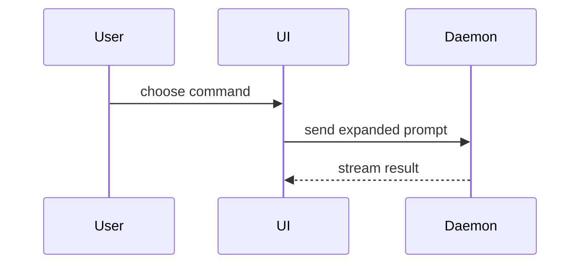

# Summary visuals

Choose the smallest visual for the PR Summary. Match its shape to the change's **main point**:

| Main point | Shape |
|---|---|
| Logic or algorithm | Pseudocode |
| Runtime call order | Call tree |
| UI structure, state, and module boundaries | Component tree |
| File responsibilities or broad refactoring | Shallow file tree |
| Component interaction, control flow, or data flow | Mermaid |
| Additions or removals in an existing structure | A `diff` of that shape |
| Mostly new code, or a copyable target shape | Complete code block |

One visual is usually enough; use at most two. Place each next to the statement it supports. Keep only calls, files, props, states, and boundaries needed to explain what changed.

## Pseudocode

```text
on(save)
  if content is unchanged
    return cached result
  write new content
  return fresh result
```

## Call tree

```text
submitForm
  createSession
    persistPrompt
    launchAgent
  navigateToSession
```

## Component tree

Show state and package boundaries that matter to understanding:

```text
<SessionPage> (apps/web/src/routes/session.tsx)
  useSessionEvents()
  <SessionToolbar>
    <RunSkillButton> (packages/ui)
```

## File tree

```text
src/
├── commands/       # parses user actions
├── sessions/       # owns session state
└── transport/      # sends API requests
```

## Mermaid



## Diff shapes

Use a `diff` of any shape above when the surrounding structure already exists and the point is what changed.

Component:

```diff
 <SessionPage>
   <SessionToolbar>
+    <RunSkillButton />
   <SessionTimeline>
+    <SkillResultCard />
```

File layout:

```diff
 src/
 ├── sessions/
-└── transport.ts
+└── transport/
+    ├── client.ts
+    └── stream.ts
```

Call tree:

```diff
 submitForm
   createSession
     persistPrompt
+    expandSkillMention
     launchAgent
```

Control flow:

```diff
 on(save)
-  write content
+  if content is unchanged
+    return cached result
+  write new content
+  invalidate cache
```
