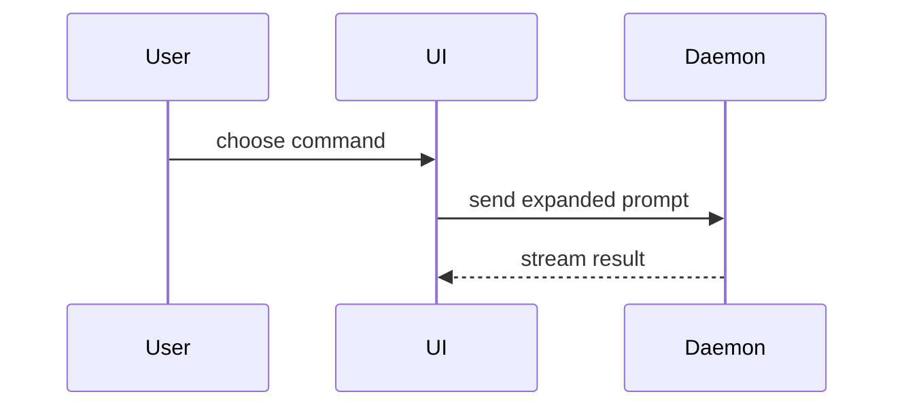

# Summary visuals

为 PR body 的 Summary 挑一个最小的图示。按改动的**主要看点**选形状：

| 看点 | 形状 |
|---|---|
| 逻辑 / 算法 | 伪代码 |
| 运行时的调用顺序 | 调用树 |
| UI 结构、状态与模块边界 | 组件树 |
| 文件职责、大范围重构 | 浅层文件树 |
| 组件交互、控制流、数据流 | Mermaid |
| 已有结构上的增删 | 对应形状的 `diff` |
| 大部分是新代码，或 reviewer 需要可复制的目标形状 | 完整代码块 |

通常一个就够，最多两个。每个图示紧挨着它要支撑的那句话；只保留回答「改了什么」所需的调用、文件、props、状态与边界。

## 伪代码

```text
on(save)
  if content is unchanged
    return cached result
  write new content
  return fresh result
```

## 调用树

```text
submitForm
  createSession
    persistPrompt
    launchAgent
  navigateToSession
```

## 组件树

标出影响理解的状态与包边界：

```text
<SessionPage> (apps/web/src/routes/session.tsx)
  useSessionEvents()
  <SessionToolbar>
    <RunSkillButton> (packages/ui)
```

## 文件树

```text
src/
├── commands/       # parses user actions
├── sessions/       # owns session state
└── transport/      # sends API requests
```

## Mermaid



## diff 形状

周围结构已经存在、要点是「变了什么」时，用 `diff` 包住上面任一形状。

组件：

```diff
 <SessionPage>
   <SessionToolbar>
+    <RunSkillButton />
   <SessionTimeline>
+    <SkillResultCard />
```

文件布局：

```diff
 src/
 ├── sessions/
-└── transport.ts
+└── transport/
+    ├── client.ts
+    └── stream.ts
```

调用树：

```diff
 submitForm
   createSession
     persistPrompt
+    expandSkillMention
     launchAgent
```

控制流：

```diff
 on(save)
-  write content
+  if content is unchanged
+    return cached result
+  write new content
+  invalidate cache
```
